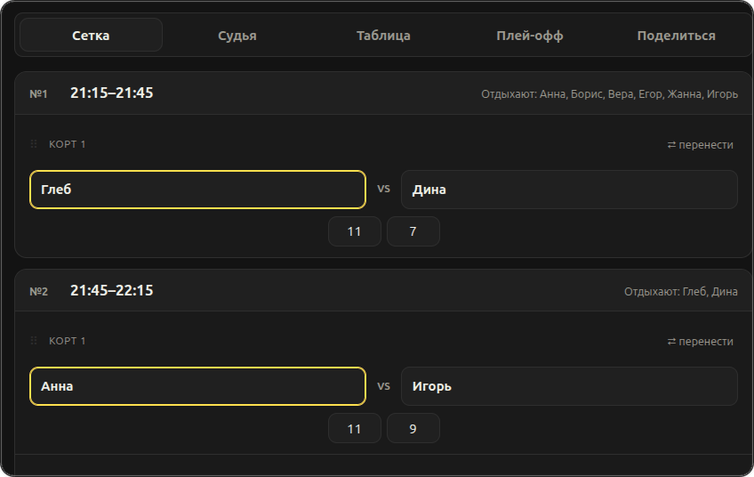
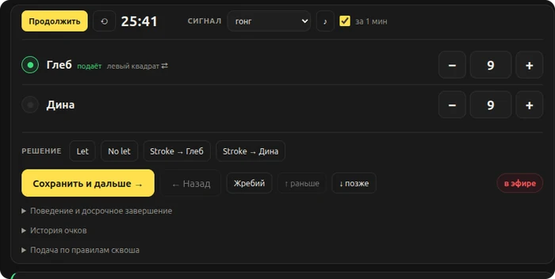
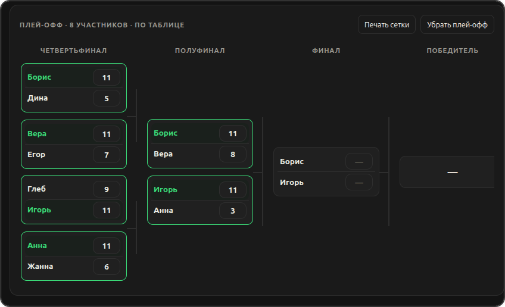
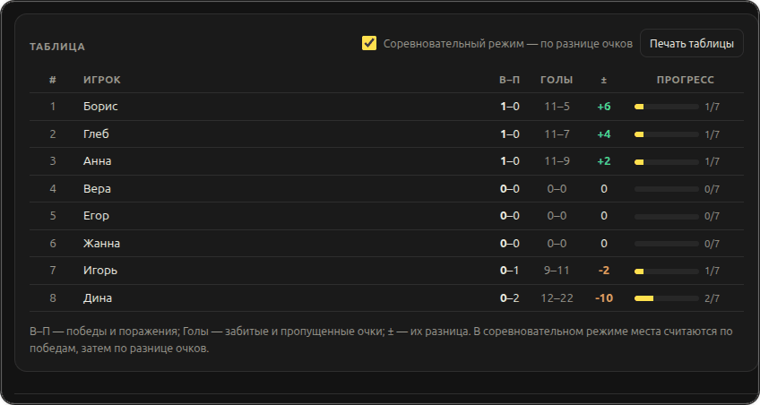
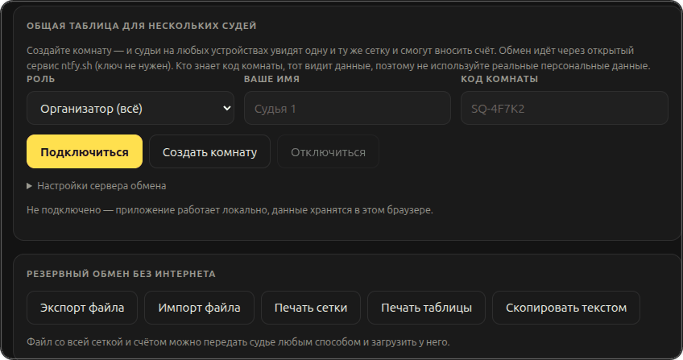

# Сквош · сетка и судейство

**Расписание, счёт и общая таблица для групповых игр в сквош.**
Один файл, без установки и зависимостей: работает офлайн в браузере. До 16 игроков и 3 кортов.

Открыть: **[difp.github.io/squashtabs](https://difp.github.io/squashtabs/)** — или скачать `index.html` и открыть файлом.

Список игроков → **«Построить сетку»** → счёт во вкладке **«Судья»** → итоги в **«Таблице»**. Для нескольких судей — **«Поделиться»**: создать комнату и раздать QR.

## Что умеет

| | |
|---|---|
| 🗓 **Сетка** | «каждый с каждым» — все пары ровно по разу, или режим «по времени». Отдых чередуется, идущие матчи помечены «в эфире» |
| 🎯 **Счёт** | партия до 11, при 10:10 — разница в 2 очка. Подача переходит вместе с очком, квадрат подачи выбирает подающий |
| ⚖️ **Судейство** | `Let` / `No let` / `Stroke`, предупреждения, история очков, досрочное завершение — травма, неявка |
| ⏱ **Таймер** | сигнал за минуту до конца и звонок на финише: звук выбирается из готовых или загружается свой |
| 🔀 **Перенос** | матч перетаскивается на нужный корт или переносится кнопкой «⇄ перенести»; занятое время — матчи меняются местами, счёт едет вместе с матчем |
| 👥 **Состав** | список игроков вставляется прямо из сообщения в чате. Замена по ходу турнира оставляет сыгранные матчи за выбывшим |
| 📊 **Таблица** | победы, забитые и пропущенные очки, разница, соревновательный режим |
| 🏆 **Плей-офф** | сетка навылет на 4, 8 или 16 участников — от 1/8 финала: по таблице или жребием, победители проходят дальше сами |
| 🖨 **Печать A4** | расписание списком, итоговая таблица с подписью судьи, сетка навылет. Перед печатью лист виден целиком, сохраняется в PDF |
| 📡 **Несколько судей** | одна сетка на всех устройствах по коду комнаты или QR-коду |

## Судейская консоль

## Плей-офф

<table>
<tr>
<td width="50%"></td>
<td width="50%"></td>
</tr>
</table>

Данные комнаты видны тем, кто знает код, — не вводите персональные данные. Без комнаты всё хранится только в браузере.

Ошибки, вопросы и идеи — [Telegram](https://t.me/sailofsoul) или [issue](https://github.com/difp/squashtabs/issues) в репозитории.
