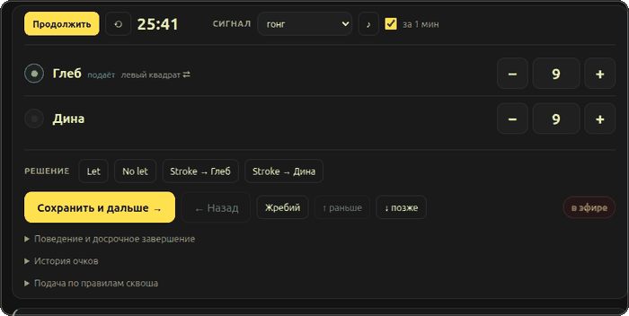
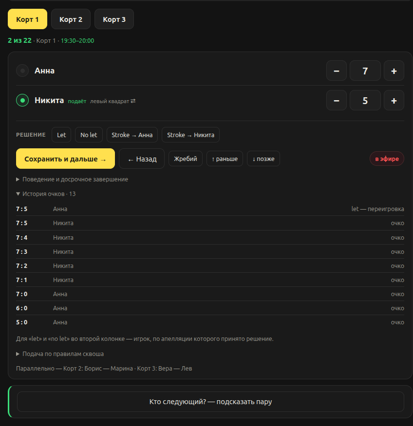


<div align="center">


# Сквош · сетка и судейство

**Расписание, счёт и таблица для групповых игр в сквош.**  
Один файл `index.html` — без сборки, зависимостей и бэкенда. Работает офлайн, ставится на GitHub Pages.


</div>

---


Сетка строится сама: время в заголовке каждой записи, отдыхающие рядом, идущие матчи помечены красным «в эфире».

## Возможности

| | |
|---|---|
| 🗓️ **Два формата** | «Каждый с каждым» — все пары ровно один раз (для 12 игроков и 3 кортов это 66 матчей, 22 записи, 11 часов). «По времени» — задаёте часы, приложение считает, сколько матчей влезет |
| 🧮 **Счёт по правилам** | Партия до 11, при 10:10 и дальше — разница в 2 очка. В таблицу матч идёт только после победы |
| 🏸 **Подача (PAR)** | Взял очко — берёшь подачу. Когда подача переходит, квадрат выбирает сам подающий, а пока он берёт очки — квадрат чередуется по его счёту |
| ⚖️ **Судейство** | `Let`, `No let`, `Stroke`, предупреждения за поведение, **история очков** и досрочное завершение (травма, неявка, поведение) |
| ↔️ **Правка расписания** | Матч перетаскивается мышью за ⠿ или сдвигается кнопками «↑ раньше / ↓ позже». «Кто следующий?» предложит пару так, чтобы не было игр подряд |
| 📋 **Состав из сообщения** | Вставьте текст из чата как есть — приложение само выберет имена |
| 🔁 **Замена игрока** | Форс-мажор: имя меняется, сыгранные матчи остаются за выбывшим, новый игрок вступает со следующего матча |
| 🤝 **Общая таблица** | Несколько судей на разных устройствах видят одну сетку и вносят счёт. Подключение по коду комнаты или **QR-коду** |
| 📊 **Таблица** | Победы, забитые и пропущенные очки, разница; соревновательный режим ранжирует по разнице |
| 🕐 **План по времени** | Длительность матча и время начала — приложение считает окончание и предупредит, если не влезает в вечер |

## Судейская консоль



Очко начисляется кнопкой «+», подача переходит сама, квадрат подающий выбирает сам. `Let` / `No let` / `Stroke` — тут же, под счётом.



## Состав из сообщения



Вставляете сообщение как есть — с нумерацией, телефонами, ссылками и эмодзи. Телефоны, ссылки, цены и служебные слова отбрасываются, «Анна Петрова» остаётся одним игроком, «Анна, Борис, Вера» — тремя. Перед добавлением видно, кого нашло и кого пропустило.

## Таблица и замена игрока


Победы, забитые и пропущенные очки, разница, прогресс. Переключатель **соревновательного режима** ранжирует по разнице очков. Если игрока заменили по ходу турнира, в таблице видны обе строки: выбывший помечен «до замены» со своими результатами, новый — «замена».

## Общая таблица для нескольких судей


Создаёте комнату — появляются ссылка и **QR-код**. В ссылке зашиты и код комнаты, и адрес сервера, поэтому судье достаточно навести камеру: приложение откроется сразу в нужной комнате. Кто не может сканировать — вводит код вручную. Роли: организатор, судья, зритель.

## Развёртывание

**GitHub Pages:** положите `index.html` в репозиторий → *Settings → Pages → Deploy from a branch → main / (root)*.
Страница окажется по адресу `https://<логин>.github.io/<репозиторий>/`.

**Локальный сервер** — если нужен обмен без публичных сервисов, всё идёт по вашей сети:

```bash
python3 server.py                     # порт 8080
python3 server.py 9000 --key ваш-ключ # с ключом доступа (для туннеля)
```

Организатор открывает `http://<IP>:8080/`, в «Поделиться» указывает этот же адрес как «Адрес сервера»
и создаёт комнату; остальные сканируют QR. Нужен только Python 3 — на macOS и Linux он уже есть.

**Связь из разных сетей.** По умолчанию обмен идёт через публичный `ntfy.sh`: судьи просто открывают
страницу и вводят код комнаты, ничего поднимать не нужно. Если нужен свой сервер, есть два пути:

| Способ | Что нужно | Где данные |
|---|---|---|
| `ntfy.sh` (по умолчанию) | ничего | через публичный сервис, лимит 250 сообщений в сутки |
| Свой сервер + [Tailscale](https://tailscale.com) | приложение у организатора и у судей | напрямую между вашими устройствами |
| Свой сервер + туннель (`cloudflared`, `ngrok`) | сервис туннеля | сервер открыт в интернет — **обязательно с ключом** |

Проброс портов на роутере обычно не работает: у мобильных операторов и многих домашних провайдеров
адреса за NAT (CGNAT). Держать сервер на телефоне тоже можно, но с оговорками: **Android** —
Termux (`pkg install python`, затем `python server.py`, плюс `termux-wake-lock`), **iPhone** —
ненадёжно, iOS выгружает приложение в фоне, поэтому лучше ноутбук или режим `ntfy`.

## Настройка под себя

В начале `index.html` два необязательных параметра — они показываются **иконками в подвале страницы**:

```js
const REPO_URL = 'https://github.com/ВАШ_ЛОГИН/имя-репозитория';  // иконка GitHub
const TG_URL   = 'https://t.me/ваш_контакт';                      // иконка Telegram
```

При наведении видно название: `GitHub · логин/репозиторий` и `Telegram · @контакт`. Оставьте заглушку
или пустую строку — соответствующая иконка просто не появится. Если не заполнить обе, блок связи в
подвале скрывается целиком.

## Что важно знать

- **Данные комнаты публичны**: кто знает код, тот их видит. Не вводите персональные данные.
- Ограничения `ntfy.sh`: **250 сообщений в сутки** и до 4 КБ на сообщение. Приложение экономит
  (одно сообщение на матч, приём потоком), но для регулярных турниров лучше свой сервер.
- Правки без связи не теряются: копятся и уходят, когда связь вернётся.
- Без комнаты приложение работает полностью локально, данные хранятся в браузере.

## Обратная связь

Нашли ошибку или есть идея — откройте issue в репозитории проекта.
